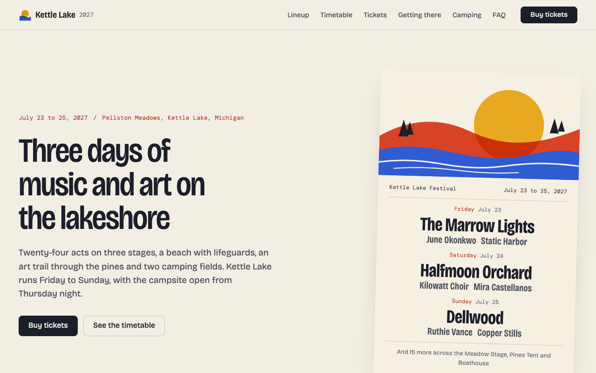

# Festival website template

A multi-day music and arts festival website with a poster-style lineup, a clickable timetable, ticket tiers, a map of the grounds, camping, FAQ and sponsors. Built with Astro as a fully static site.



[](https://console.cloudzyro.com/new?repo=https://github.com/Cloudzyro/template-festival)

## What's included

- Hero with the festival poster: printed-look artwork and the headliners for each day, drawn from your data
- Lineup by day and stage, headliner first, with day tabs (without JavaScript every day is shown)
- Timetable page (`/timetable/`): a grid of every set by stage and time for each day; choose a set to read about the artist and save it to "my plan", stored in the visitor's browser, with an "Only my plan" filter
- Ticket tiers shown as ticket stubs, each linking to your ticketing page
- Getting there: address, shuttle, car, bike and airport notes, a drawn map of the grounds and an "Open in maps" link
- Camping, FAQ with accessible expand and collapse, sponsor wordmarks
- Newsletter sign-up that posts to any form service, with an email fallback
- SEO: page titles and descriptions, Open Graph and Twitter cards, `sitemap-index.xml`, `robots.txt`, favicon
- Responsive down to 360px, keyboard friendly, visible focus styles, respects reduced motion
- No tracking and no third-party scripts; fonts are self-hosted

## Run it locally

```bash
pnpm install
pnpm dev       # http://localhost:4321
pnpm build     # static site in dist/
pnpm preview   # serve the build
```

Requires Node 22.23 or newer (`.nvmrc` pins 24).

## Make it yours

**Content.** Everything lives in [`src/data/festival.ts`](./src/data/festival.ts): name, dates, place, ticket link, navigation, days and gate times, stages and their colors, artists, set times, poster headliners, tickets, travel, camping, FAQ, sponsors and the newsletter text. Set times are written as 24-hour `"HH:MM"` and shown as `6:30 pm`. The timetable grid sizes itself from each day's `first` and `last` times.

**Tickets.** Set `ticketUrl` to your ticketing page (Eventbrite, Dice, a Stripe or Paddle payment link, anything with a URL).

**Newsletter form.** Set a public environment variable to the address your form service gives you:

```bash
PUBLIC_FORM_ENDPOINT=https://formspree.io/f/your-form-id
```

It works with Formspree, Basin, a Supabase function or anything that accepts a form POST. Without it, the form says it isn't connected yet and opens the visitor's email app addressed to `contactEmail`. Copy `.env.example` to `.env` for local development; on Cloudzyro, add the variable in your site's settings and redeploy.

**Site address.** Set `SITE_URL` (or edit the fallback in `astro.config.mjs`) so the sitemap, `robots.txt` and social previews use your domain.

**Colors and fonts.** Paper, ink and accent tokens are at the top of [`src/styles/global.css`](./src/styles/global.css); stage colors are in `festival.ts`. Fonts are Bricolage Grotesque (with its width axis for the condensed poster type) and DM Mono from Fontsource; change the imports in `src/layouts/Base.astro` and the `--font` and `--mono` tokens.

**Images.** The poster art is SVG in `src/components/Poster.astro` and the grounds map is `src/components/SiteMap.astro`. Sponsors show as wordmarks; to use real logos put files in `public/` and set `logo: "/your-logo.svg"`. Replace `public/og.png` (1200x630) with your own social preview.

## Deploy

Click **Deploy to Cloudzyro** above, or push your own copy to GitHub and connect the repository in the Cloudzyro console. The build command is `pnpm build` and the output is the static `dist/` folder, so no server is needed.

## Stack

- [Astro](https://astro.build) 7, static output
- Hand-written CSS with custom properties
- [Fontsource](https://fontsource.org) self-hosted fonts
- `@astrojs/sitemap`

## License

MIT, see [LICENSE](./LICENSE).
